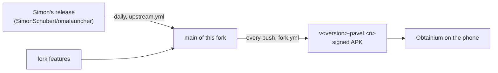

<!-- petrzpav's fork: GitHub shows .github/README.md on the repository page before the root README.md, which stays
     upstream's, so the daily upstream merge never conflicts on it. -->

<div align="center">


# Omalauncher (petrzpav's fork)

**[Simon Schubert's Omalauncher](https://github.com/SimonSchubert/omalauncher), plus a few features of my own, built for Obtainium.**

An Android home screen with the look of [Omarchy](https://omarchy.org), widgets you write (or have an agent write) in OWL,
and an optional Arch Linux ARM next to your phone apps, without root.

[](https://github.com/petrzpav/omalauncher/releases/latest)
[](https://github.com/SimonSchubert/omalauncher/releases/latest)
[](https://github.com/petrzpav/omalauncher/actions/workflows/fork.yml)
[](../LICENSE)

<a href="https://apps.obtainium.imranr.dev/redirect?r=obtainium://add/https://github.com/petrzpav/omalauncher"></a>


</div>

> [!NOTE]
> This is an unofficial fork. Omalauncher is Simon's project: for the stable app use
> [Google Play](https://play.google.com/store/apps/details?id=dev.omalauncher), and report upstream bugs
> [there](https://github.com/SimonSchubert/omalauncher/issues). Everything Omalauncher does is described in its
> [README](../README.md); this page covers only what the fork adds.

## What's added

| | Feature | What it does |
|---|---|---|
| 📞 | **Phone app with calls from every app** | `android.calls` and an example owl app, [`phone.owl`](../app/src/main/assets/widgets/examples/phone.owl): one call history for the phone, WhatsApp and Messenger, by day, as on an iPhone. Calls from other apps are recorded from their call notifications. It has contact search, a keypad and callback through the app the call came from (a WhatsApp call starts a WhatsApp call). Swipe a call to delete it, with five seconds to undo. ([#321](https://github.com/SimonSchubert/omalauncher/issues/321)) |
| 🎵 | **Linux players in Android's media controls** | `omalauncher media set …` shows what a Linux player plays on the lock screen, in the shade, on a watch, on headset and AirPods buttons, and in the car over Bluetooth. ([#267](https://github.com/SimonSchubert/omalauncher/pull/267)) |
| 🚗 | **Android Auto** | The launcher shows up as a media app in Android Auto. A Linux player takes audio focus, so the car switches to it and a call pauses it. It has −30 s / +30 s buttons, and "play on Omalauncher" works by voice. |
| 🪟 | **`android.windows`** | A widget can list the open Linux windows and bring one to the front with `open(w.key)`, for example the terminal an agent is running in. ([#286](https://github.com/SimonSchubert/omalauncher/pull/286)) |
| 🔔 | **A widget's own notification** | `notification:` and `onNotification`: a notification that stays and changes, with a countdown Android keeps running on the lock screen and up to three buttons. A timer can be paused from the lock screen. ([#280](https://github.com/SimonSchubert/omalauncher/pull/280)) |

The widget docs that ship in the app describe all of these, so agents on the phone can use them
(the [OWL docs](../app/src/main/assets/widgets/docs/), marked "in this fork" where they differ).

## Install

1. Install [Obtainium](https://github.com/ImranR98/Obtainium) and tap the badge above, or add
   `https://github.com/petrzpav/omalauncher` by hand.
2. Obtainium installs `dev.omalauncher.pavel`. It's an app of its own, with its own signing key, so it
   **sits beside the launcher from Play** and doesn't replace it, and your Play install and its Linux stay as they are.

Or download the APK from [Releases](https://github.com/petrzpav/omalauncher/releases/latest) (`SHA256SUMS` is next to it).
The update check in settings stays quiet, since Obtainium does the updating.

Needs an arm64 phone with Android 10 or newer, like upstream.

## How it stays up to date



- Once a day, [`upstream.yml`](workflows/upstream.yml) merges Simon's newest release into `main`. A release that
  conflicts is never forced: `main` stays as it is, and the run fails with the files to resolve by hand.
- Every push to `main` runs the tests and [`fork.yml`](workflows/fork.yml) publishes a signed
  `v<version>-pavel.<n>` release, so the fork's version always says which upstream release it is built on.

## Building

As in upstream (see its [README](../README.md#building) and [AGENTS.md](../AGENTS.md)):

```sh
./scripts/fetch-proot.sh          # once per checkout, needs bsdtar
./gradlew :owl:test :app:testFossDebugUnitTest :owl:owlJar
./gradlew :app:installFossDebug   # dev.omalauncher.pavel, debug-signed (uninstall the Obtainium one first)
```

## Credits

All the credit for Omalauncher goes to **[Simon Schubert](https://github.com/SimonSchubert)** and its
[contributors](https://github.com/SimonSchubert/omalauncher/graphs/contributors). The fork's additions were offered
upstream first (the links above), and any of them can go upstream whenever Simon wants it.

MIT, like upstream. See [LICENSE](../LICENSE) and [THIRD_PARTY.md](../THIRD_PARTY.md). Omalauncher and this fork
aren't affiliated with or endorsed by Omarchy, Arch Linux, or the makers of the coding agents it installs.
